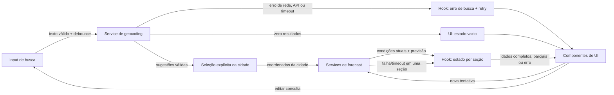

# Architecture

Weather App será uma SPA responsiva em pt-BR organizada em quatro camadas.
Dependências seguem em uma direção: apresentação → hooks → services → APIs
externas. As funções puras de `lib/` podem ser chamadas pelas camadas que
precisarem delas, mas não dependem de React, rede ou estado global.

```text
components/  apresentação, acessibilidade e eventos do usuário
     │
     ▼
hooks/       estado da tela, coordenação e ciclo de vida das operações
     │
     ▼
services/    HTTP, timeout, cancelamento e adaptação das respostas externas
     │                          │
     │                          └── lib/ funções puras compartilhadas
     ▼
Open-Meteo APIs
```

**Apresentação (`components/`):** componentes exibem dados e estados
(`loading`, vazio, parcial e erro), recebem valores e callbacks por props e
comunicam ações do usuário. Não chamam APIs, não coordenam requisições e não
duplicam regras de conversão ou interpretação meteorológica.

**Orquestração e estado (`hooks/`):** `useWeather` mantém busca, sugestões,
cidade selecionada, condições atuais, previsão e unidade. Coordena debounce,
seleção explícita, carregamentos independentes, retries e invalidação de
respostas antigas. Delega I/O aos serviços e expõe estado e ações à tela; não
conhece detalhes de apresentação nem constrói URLs.

**Acesso a dados (`services/`):** funções de serviço montam requisições para
Geocoding e Forecast, aplicam timeout/cancelamento, verificam erros HTTP e
validam/mapeiam respostas da Open-Meteo para os tipos internos. Não mantêm
estado de UI nem dependem de componentes. Recebem `AbortSignal` quando o hook
precisa cancelar ou substituir uma operação.

**Funções puras (`lib/`):** regras determinísticas e sem efeitos colaterais:
validar cidade e coordenadas, mapear códigos WMO, lidar com valores
indisponíveis, calcular as cinco datas no fuso da localidade, formatar valores
e converter temperaturas. Recebem seus dados como argumentos e são fáceis de
testar isoladamente.

Não haverá servidor próprio, conta, geolocalização do dispositivo, cache,
persistência ou atualização em segundo plano na v1. A cidade e a unidade vivem
somente na sessão atual (RF-01, RF-04, RNF-07).

# Tech Stack

- **React, Vite e TypeScript strict:** stack definida pelo projeto; componentes
  acessíveis e contratos tipados.
- **`fetch` e `AbortController`:** chamadas HTTP, cancelamento e limite de
  tempo sem adicionar uma biblioteca de rede.
- **Estado local React em `useWeather`:** suficiente para esta tela e para as
  operações independentes, sem gerenciador global externo.
- **Vitest + Testing Library:** testes unitários e de componentes.
- **Playwright:** testes dos fluxos integrados no navegador.
- **`Intl` do navegador:** apresentação de datas em pt-BR e cálculo/formatação
  de data local usando o fuso IANA da cidade, nunca o fuso do dispositivo.
- **Biome:** lint e formatação conforme o stack do projeto.

# Project Structure

Na etapa mock, `App` compõe os componentes e `useMockWeather` mantém consulta,
seleção, sugestões, unidade e estados independentes. O hook aplica debounce
de 300 ms com limpeza do timer na edição/unmount; o catálogo e os cenários
parciais ficam em `src/mocks/`. Não há serviços de rede. `src/main.tsx` monta React em `#root` e importa
`src/styles/global.css` com as diretivas Tailwind. O mock identifica Salvador,
Bahia, no fuso `America/Bahia`; temperaturas continuam em Celsius e são
convertidas apenas nos componentes de apresentação. O seletor de cenário
pertence apenas ao demonstrador. `SearchBar` aceita modo controlado com
`query`, `onQueryChange`, `suggestions` e `onSelect`, preservando o modo de
envio simples com `onSearch`. `WeatherSection` compõe estado e conteúdo,
preservando foco em um contêiner persistente ao executar retry.
`ErrorState` recebe operação/status; `EmptyState` oferece editar/repetir.
`DataDisclosure` informa modo local sem atribuição aprovada inventada.

Organização proposta em `src/`, seguindo as convenções do projeto:

```text
src/
  App.tsx
  components/
    SearchBar.tsx                 # Campo, sugestões e seleção acessível
    CurrentWeather.tsx            # Apresentação das condições atuais
    ForecastList.tsx              # Lista de cinco datas
    ForecastCard.tsx              # Apresentação de uma data
    UnitToggle.tsx                # Controle de unidade
    states/
      LoadingState.tsx            # Estado de carregamento
      EmptyState.tsx              # Busca/resultado vazio
      ErrorState.tsx              # Erro e ação de retry
  hooks/
    useWeather.ts                 # Estado e orquestração da tela
  services/
    geocodingService.ts           # Requisição e adaptação de geocoding
    weatherService.ts             # Requisições atuais e diárias
  types/
    weather.ts                    # Contratos internos compartilhados
  lib/
    validation.ts                 # Validação pura de cidade e valores
    weatherCodes.ts               # Mapeamento de códigos WMO
    temperature.ts                # Conversões de unidade
    dates.ts                      # Datas locais no fuso da cidade
    format.ts                     # Formatação de apresentação
tests/
  unit/                           # Testes de funções, serviços, hooks e componentes
  e2e/                            # Fluxos integrados com Playwright
```

`components/` não importa `services/` diretamente; a tela conecta componentes
ao hook. `hooks/` pode importar serviços e funções puras; `services/` pode usar
funções puras, mas não React. Tipos compartilhados ficam em `types/` para
evitar dependência circular. Manter cada arquivo pequeno e não criar módulos
adicionais sem uma responsabilidade concreta.

Essa separação permite testar as regras de `lib/` com entradas e saídas
determinísticas; testar `services/` simulando `fetch` e `AbortSignal`; testar o
hook com serviços simulados e relógio controlado; e testar componentes por
renderização, interação e acessibilidade, sem rede real. Playwright valida a
integração entre as camadas com respostas de API controladas.

# Data Model

Contratos internos propostos. Respostas externas devem ser tratadas como dados
não confiáveis e validadas antes de serem mapeadas. Um valor ausente, nulo,
inválido ou não finito é indisponível, nunca substituído por zero.

```ts
type Unit = "celsius" | "fahrenheit";

interface City {
  name: string;
  admin1?: string;
  country?: string;
  latitude: number;
  longitude: number;
  timezone?: string;
}

type WeatherField<T> =
  | { available: true; value: T }
  | { available: false };

interface CurrentWeather {
  temperatureC: WeatherField<number>;
  conditionLabel: WeatherField<string>;
  humidityPercent: WeatherField<number>;
  windKmh: WeatherField<number>;
  pressureHpa: WeatherField<number>;
  precipitationMm: WeatherField<number>;
  updatedAt: string | null;
}

interface ForecastDay {
  date: string; // YYYY-MM-DD no calendário local da cidade
  minTemperatureC: WeatherField<number>;
  maxTemperatureC: WeatherField<number>;
  conditionLabel: WeatherField<string>;
  precipitationProbabilityPercent: WeatherField<number>;
  precipitationMm: WeatherField<number>;
  windKmh: WeatherField<number>;
}

interface WeatherData {
  city: City;
  current: CurrentWeather;
  forecast: ForecastDay[];
}

type OperationStatus =
  | "idle"
  | "loading"
  | "success"
  | "partial"
  | "empty"
  | "error"
  | "timeout";

interface SectionState<T> {
  status: OperationStatus;
  data: T | null;
  error: WeatherError | null;
}

type WeatherError =
  | { kind: "network"; message: string }
  | { kind: "http"; message: string }
  | { kind: "invalid-response"; message: string }
  | { kind: "timeout"; message: string };

interface WeatherState {
  query: string;
  suggestions: City[];
  searchStatus: OperationStatus;
  searchError: WeatherError | null;
  selectedCity: City | null;
  current: SectionState<CurrentWeather>;
  forecast: SectionState<ForecastDay[]>;
  unit: Unit;
}
```

`CurrentWeather` e `ForecastDay` mantêm temperaturas em Celsius como valor de
origem; a conversão ocorre apenas na apresentação. Uma previsão bem-sucedida
contém exatamente cinco `ForecastDay`, inclusive datas sem campos disponíveis.
O rótulo de condição só existe para códigos WMO reconhecidos; códigos ausentes
ou desconhecidos produzem `available: false` (RF-02, RF-03, RF-04).

# Data Flow

1. **Busca:** após pelo menos dois caracteres não brancos e 300 ms sem nova
   digitação, iniciar geocoding. Mudanças no texto cancelam o debounce e
   invalidam ou abortam a consulta anterior; texto em branco não gera chamada
   (RF-01, CA-01.1, CA-01.5).
2. **Sugestões:** validar nome não vazio e coordenadas finitas nos intervalos
   inclusivos latitude −90° a 90° e longitude −180° a 180°. Preservar grafia
   e ordem do provedor; exibir até cinco resultados válidos. A seleção é
   sempre explícita e a identificação inclui região e país quando fornecidos
   (RF-01, CA-01.3, CA-01.6, CA-01.8, CA-01.11, CA-01.12).
3. **Seleção:** armazenar a cidade escolhida com suas coordenadas. Iniciar
   condições atuais e previsão apenas depois da seleção explícita. Ao trocar
   de cidade, limpar dados da cidade anterior para não associar resultados ao
   local errado; somente respostas da seleção mais recente podem atualizar a
   tela (CA-01.4, CA-02.2, CA-03.3).
4. **Consulta meteorológica:** executar condições atuais e previsão em paralelo,
   como operações independentes, cada uma com seu próprio limite de 5 s e
   retry. Mapear campos individualmente; uma falha não apaga dados válidos da
   outra seção (RF-02, RF-03, RF-05, RNF-05).
5. **Datas da previsão:** usar o fuso IANA retornado pelo provedor para
   determinar a data local de hoje e construir as cinco datas consecutivas.
   Associar dados somente pela data `YYYY-MM-DD`; datas/campos ausentes ficam
   visíveis como indisponíveis e valores não são deslocados entre dias
   (RF-03, CA-03.1, CA-03.4, CA-03.7, CA-03.9).
6. **Apresentação:** componentes exibem estados de carregamento, vazio, parcial
   e erro por operação. Alternar a unidade re-renderiza todas as temperaturas
   a partir dos valores Celsius de origem, sem nova chamada ou mudança nos
   demais dados (RF-04, CA-04.4).



Uma resposta de forecast pode atualizar somente a seção correspondente;
falha de condições atuais não remove previsão válida e vice-versa. Respostas
de buscas ou seleções substituídas são ignoradas para não alterar os dados da
cidade mais recente (RF-05, RNF-05).

# External APIs

## Geocoding

- **Endpoint:** `GET https://geocoding-api.open-meteo.com/v1/search`
- **Parâmetros:** `name={query}` (nome pesquisado), `count=100` (candidatos a
  filtrar), `language=pt` (nomes localizados) e `format=json` (formato da
  resposta; JSON é o padrão).
- **Exemplo de URL:**
  `https://geocoding-api.open-meteo.com/v1/search?name=S%C3%A3o%20Paulo&count=100&language=pt&format=json`
- **Resposta resumida:**

  Exemplo esquemático; valores ilustrativos.

  ```json
  {
    "results": [
      {
        "id": 3448439,
        "name": "São Paulo",
        "latitude": -23.5475,
        "longitude": -46.6361,
        "timezone": "America/Sao_Paulo",
        "country": "Brasil",
        "admin1": "São Paulo"
      }
    ]
  }
  ```

- **Mapeamento:** cada elemento válido de `results` vira um `City`: `name`,
  `latitude`, `longitude`, `timezone`, `country` e `admin1` mapeiam para os
  campos homônimos. Região, país e fuso podem estar ausentes; não os inventar.
  `id` pode servir como chave de interface, mas não substitui a validação de
  nome e coordenadas. Rejeitar nome vazio, coordenadas não finitas ou fora dos
  intervalos inclusivos da RF-01. Filtrar antes de limitar a cinco resultados
  para preservar até cinco sugestões válidas, na ordem do provedor.

## Forecast

- **Endpoint:** `GET https://api.open-meteo.com/v1/forecast`
- **Parâmetros comuns:** `latitude={city.latitude}`,
  `longitude={city.longitude}`, `timezone=auto`,
  `temperature_unit=celsius`, `wind_speed_unit=kmh`,
  `precipitation_unit=mm` e `timeformat=iso8601`. O timezone automático
  derivado das coordenadas é retornado em `timezone`; usar esse fuso para
  interpretar as datas locais.
- **Condições atuais:** solicitar `current=temperature_2m,relative_humidity_2m,precipitation,weather_code,wind_speed_10m,surface_pressure`.
- **Previsão diária:** solicitar
  `daily=weather_code,temperature_2m_max,temperature_2m_min,precipitation_probability_max,precipitation_sum,wind_speed_10m_max`
  e `forecast_days=5`.
- **Exemplo de URL para condições atuais:**
  `https://api.open-meteo.com/v1/forecast?latitude=-23.5475&longitude=-46.6361&current=temperature_2m,relative_humidity_2m,precipitation,weather_code,wind_speed_10m,surface_pressure&timezone=auto&temperature_unit=celsius&wind_speed_unit=kmh&precipitation_unit=mm&timeformat=iso8601`
- **Resposta resumida de condições atuais:**

  Exemplo esquemático; valores ilustrativos.

  ```json
  {
    "latitude": -23.55,
    "longitude": -46.63,
    "timezone": "America/Sao_Paulo",
    "current_units": {
      "temperature_2m": "°C",
      "relative_humidity_2m": "%",
      "precipitation": "mm",
      "weather_code": "wmo code",
      "wind_speed_10m": "km/h",
      "surface_pressure": "hPa"
    },
    "current": {
      "time": "2026-10-27T14:00",
      "interval": 900,
      "temperature_2m": 22.4,
      "relative_humidity_2m": 65,
      "precipitation": 0.0,
      "weather_code": 2,
      "wind_speed_10m": 10.1,
      "surface_pressure": 1014.2
    }
  }
  ```

- **Exemplo de URL para previsão diária:**
  `https://api.open-meteo.com/v1/forecast?latitude=-23.5475&longitude=-46.6361&daily=weather_code,temperature_2m_max,temperature_2m_min,precipitation_probability_max,precipitation_sum,wind_speed_10m_max&forecast_days=5&timezone=auto&temperature_unit=celsius&wind_speed_unit=kmh&precipitation_unit=mm&timeformat=iso8601`
- **Resposta resumida de previsão:**

  Exemplo esquemático; valores ilustrativos.

  ```json
  {
    "timezone": "America/Sao_Paulo",
    "daily_units": {
      "time": "iso8601",
      "weather_code": "wmo code",
      "temperature_2m_max": "°C",
      "temperature_2m_min": "°C",
      "precipitation_probability_max": "%",
      "precipitation_sum": "mm",
      "wind_speed_10m_max": "km/h"
    },
    "daily": {
      "time": [
        "2026-10-27",
        "2026-10-28",
        "2026-10-29",
        "2026-10-30",
        "2026-10-31"
      ],
      "weather_code": [2, 3, 61, 2, 1],
      "temperature_2m_max": [27.1, 25.8, 23.2, 26.0, 27.4],
      "temperature_2m_min": [18.3, 17.9, 18.1, 17.5, 18.0],
      "precipitation_probability_max": [10, 30, 80, 20, 0],
      "precipitation_sum": [0.0, 0.2, 5.4, 0.0, 0.0],
      "wind_speed_10m_max": [14.0, 18.4, 21.2, 16.8, 13.1]
    }
  }
  ```

- **Mapeamento para os tipos do modelo:**

  | Resposta Open-Meteo | Campo interno |
  | --- | --- |
  | Geocoding `results[n].name`, `admin1`, `country`, `latitude`, `longitude`, `timezone` | `City.name`, `admin1`, `country`, `latitude`, `longitude`, `timezone` |
  | `current.temperature_2m` | `CurrentWeather.temperatureC` |
  | `current.relative_humidity_2m` | `CurrentWeather.humidityPercent` |
  | `current.precipitation` | `CurrentWeather.precipitationMm` |
  | `current.wind_speed_10m` | `CurrentWeather.windKmh` |
  | `current.surface_pressure` | `CurrentWeather.pressureHpa` |
  | `current.weather_code` | Código WMO conhecido para `CurrentWeather.conditionLabel`; desconhecido ou ausente vira indisponível |
  | `current.time` | `CurrentWeather.updatedAt` somente se a semântica de atualização atender RNF-04; confirmar no gate P1 |
  | `daily.time[i]` | `ForecastDay.date` |
  | `daily.temperature_2m_min[i]`, `temperature_2m_max[i]` | `ForecastDay.minTemperatureC`, `maxTemperatureC` |
  | `daily.weather_code[i]` | Código WMO conhecido para `ForecastDay.conditionLabel`; desconhecido ou ausente vira indisponível |
  | `daily.precipitation_sum[i]` | `ForecastDay.precipitationMm` |
  | `daily.precipitation_probability_max[i]` | `ForecastDay.precipitationProbabilityPercent`; validar valor finito de 0 a 100 inclusive e unidade `%`, sem inferir de mm |
  | `daily.wind_speed_10m_max[i]` | `ForecastDay.windKmh` |
  | `timezone` | `City.timezone`; usar para associar `daily.time` às datas locais |

As chamadas de condições atuais e previsão usam o mesmo endpoint, mas são
separadas para permitir falha e retry independentes. Agregar a cidade
selecionada, condições atuais e cinco `ForecastDay` no `WeatherData` da
aplicação. As respostas diárias são arrays paralelos: mapear pelo índice
associado a `daily.time`; se faltar uma data ou campo, preservar a data esperada
e marcar apenas os valores ausentes como indisponíveis, sem deslocar valores de
outros dias (CA-03.4, CA-03.7). `current_units` e `daily_units` descrevem as
unidades retornadas e devem ser conferidos; não substituem os rótulos internos
nem justificam conversão implícita.

Mapear códigos WMO documentados para rótulos em pt-BR; código desconhecido não
recebe interpretação. A interface deve atribuir a fonte conforme os termos
confirmados do provedor e apresentar uma nota concisa sobre cobertura e
atualidade dos dados. A busca envia o texto digitado ao serviço de geocoding;
as consultas meteorológicas enviam as coordenadas da localidade selecionada.
Essas chamadas também revelam ao provedor o endereço IP de origem. A ausência
de conta ou de persistência pelo aplicativo não implica ausência de logs ou
retenção pelo provedor.

Antes do lançamento, confirmar e registrar as práticas aplicáveis de tratamento
e retenção do provedor e se é necessário aviso ou consentimento. Informar à
pessoa, de forma concisa e acessível, que o nome pesquisado e as coordenadas
selecionadas são enviados à Open-Meteo, junto à atribuição e às notas de
cobertura/atualidade exigidas pelos termos. Enviar somente os dados necessários
para as operações definidas na spec. Se o compartilhamento ou as práticas de
retenção forem incompatíveis com RNF-07, bloquear o lançamento e reavaliar o
provedor ou a arquitetura; um proxy pode ocultar o IP do cliente, mas não deixa
de transmitir a consulta ao provedor.

**Gate P1 — semântica do provedor:** confirmar na documentação do Open-Meteo
quais campos satisfazem as definições de precipitação atual e diária e
probabilidade diária de chuva (`precipitation_probability_max`, proposta ainda
pendente de confirmação neste gate), qual
timestamp representa a atualização exigida por RNF-04 e qual tabela WMO usar.
Não presumir que o horário da resposta representa a atualização dos dados. Se
o provedor não atender RF-02, RF-03 ou RNF-04, revisar a especificação antes de
implementar.

# State Management

O estado da tela vive em `useWeather`, sem store global nem persistência. A
busca, condições atuais e previsão mantêm status independentes para que o
carregamento ou falha de uma operação não esconda o resultado da outra.
`selectedCity`, texto da busca, sugestões e `unit` também pertencem ao hook.
Cada sessão começa em Celsius; cidade e unidade não são persistidas (RF-01,
RF-04, RNF-07).

Cada operação remota usa os estados explícitos abaixo:

```ts
type OperationStatus =
  | "idle"
  | "loading"
  | "success"
  | "empty"
  | "partial"
  | "error"
  | "timeout";

interface OperationState<T> {
  status: OperationStatus;
  data: T | null;
  error: WeatherError | null;
}
```

- `idle`: operação ainda não iniciada, por exemplo, antes da seleção explícita
  de uma cidade.
- `loading`: requisição em andamento; pode manter dados anteriores válidos
  durante retry da mesma cidade/seção.
- `success`: resposta válida com os dados requeridos utilizáveis.
- `empty`: busca concluída sem resultados; distinto de erro de rede/API.
- `partial`: resposta válida, mas com um ou mais campos/datas indisponíveis.
- `error`: falha de rede, HTTP/API ou resposta estruturalmente inválida.
- `timeout`: a operação excedeu 5 segundos; é distinto de erro genérico.

Para busca, `empty` representa zero sugestões; resultados retornados, mas
todos inválidos, devem gerar mensagem de cidade não identificável, não uma
sugestão selecionável. Para clima, uma resposta sem qualquer campo utilizável
não é `success` nem sucesso vazio: informar indisponibilidade e permitir retry
ou nova busca (CA-01.2, CA-01.8, CA-02.6). `partial` mantém valores disponíveis
e marca os demais como indisponíveis.

Temperaturas ficam armazenadas no modelo em Celsius, valor de origem. `unit`
é somente preferência de apresentação (`"celsius" | "fahrenheit"`) e começa
em `"celsius"`. O componente deriva
o valor exibido durante a renderização; alternar unidade não chama serviços,
não altera cidade, timestamps ou campos meteorológicos. Converter diretamente
do valor Celsius original (nunca de um valor já convertido/arredondado):

```ts
const displayed =
  unit === "fahrenheit" ? (temperatureC * 9) / 5 + 32 : temperatureC;
```

Formatar com uma casa decimal, arredondamento de empates para longe de zero, e
o sufixo `°C` para `"celsius"` ou `°F` para `"fahrenheit"`, conforme RF-04.
Manter a função pura de conversão e formatação em `lib/temperature.ts`.

Ao alterar texto, cidade ou iniciar nova tentativa, invalidar a operação
anterior com `AbortController` e/ou identificador sequencial. Só a tentativa
vigente pode atualizar o estado; timeout e cancelamento impedem respostas
tardias de sobrescrever o resultado. Trocar cidade limpa os dados meteorológicos
da cidade anterior. Retry de uma seção preserva contexto e estado/dados válidos
das outras seções (RF-05, CA-01.10, CA-02.5, CA-03.6).

# Error Handling

- **Rede:** distinguir ausência de conexão, falha de DNS e outros erros de
  transporte como falha da operação (sem apresentá-la como busca vazia).
  Preservar a consulta/cidade e oferecer retry. Não ocultar dados válidos de
  outras seções (RF-05, RNF-05).
- **API/HTTP:** verificar `response.ok` e tratar status HTTP não bem-sucedidos
  ou erro explícito do provedor como erro da operação correspondente. Não
  assumir formato de sucesso nem transformar erro HTTP em lista vazia.
  Apresentar mensagem clara sobre qual operação falhou e oferecer retry.
- **Timeout:** cada chamada remota tem limite de 5 segundos. Abortar a chamada,
  definir status `timeout`, preservar busca/cidade selecionada e oferecer
  tentativa novamente. Ignorar qualquer resposta que chegue após o timeout
  (RNF-05, CA-01.10, CA-02.5, CA-03.6).
- **Resposta inválida:** JSON ilegível ou estrutura incompatível com o contrato
  é erro de resposta; validar antes de mapear. Não usar valores padrão que
  possam mascarar falha.
- **Resposta parcial:** validar cada campo independentemente. Valores ausentes,
  `null`, não finitos ou códigos WMO desconhecidos ficam indisponíveis; zero
  fornecido pelo serviço é válido. Manter campos/datas válidos, marcar a seção
  `partial` e nunca deslocar valores entre datas (CA-02.3, CA-03.4, CA-03.7,
  CA-03.8, CA-03.10).
- **Sem dados utilizáveis:** se não houver nenhum campo meteorológico válido,
  informar que os dados estão indisponíveis e não exibir estado de sucesso.
  Permitir retry ou nova busca (CA-01.7, CA-02.6).
- **Falha independente:** busca, condições atuais e previsão têm mensagens e
  retries próprios. Falha de uma não apaga dados válidos de outra; retry
  atualiza somente a operação solicitada (RF-05, CA-02.4, CA-03.5).
- **Atualidade:** rotular condições como atuais somente quando timestamp
  interpretável tiver até uma hora. Sem timestamp, explicar que o horário é
  desconhecido; com mais de uma hora, indicar dados desatualizados
  (RNF-04, CA-02.7, CA-02.8).
- **Fuso ausente/inválido:** não inferir datas pelo fuso do dispositivo;
  indicar que não foi possível determinar a previsão local (CA-03.9).

# Testing Strategy

- **Vitest — funções puras (`lib/`):**
  - testar conversão Celsius/Fahrenheit nos dois sentidos a partir do valor de
    origem, sem conversão de valor arredondado, uma casa decimal, identificação
    da unidade e empates arredondados para longe de zero (RF-04, CA-04.1 a
    CA-04.5);
  - cobrir validação de nome/coordenadas, filtragem e limite de sugestões,
    reconhecimento de códigos WMO, datas locais nos cinco dias e regras para
    campos ausentes, nulos, inválidos ou não finitos.
- **Vitest — serviços (`services/`):** substituir `fetch` por mocks e testar
  URLs/parâmetros enviados, parsing e mapeamento das respostas válidas,
  respostas parciais, JSON inválido, erros HTTP/API, falhas de rede,
  `AbortSignal` e timeout de 5 s. Verificar que arrays diários são associados
  por índice/data sem deslocar valores e que campos ausentes não viram zero.
- **Vitest + Testing Library — hooks e componentes:** usar relógio controlado
  para debounce e timeout; simular serviços para confirmar respostas tardias,
  cancelamento, retry e independência entre busca, condições atuais e
  previsão. Testar os componentes em cada estado visível: `loading`, erro,
  vazio e sucesso, além de dados parciais; conferir conteúdo acessível,
  seleção explícita, ações de retry e alternância de unidade sem novo request.
  Os testes do hook confirmam que apenas a resposta vigente altera o estado.
- **Playwright — E2E:** cobrir o percurso de digitação até seleção explícita,
  desambiguação de cidades homônimas, renderização das condições atuais e das
  cinco datas locais, alternância de unidade sem nova consulta, e recuperação
  de busca/clima vazios, parciais, erro e timeout. Interceptar as APIs com
  fixtures determinísticas para que o teste não dependa da disponibilidade do
  Open-Meteo; manter verificação sintética operacional separada.
- **Playwright — viewport mobile e compatibilidade:** executar fluxos
  principais em 320 px (limite mínimo da spec), em um viewport mobile comum e
  em desktop, verificando ausência de rolagem horizontal, legibilidade,
  interação e acesso a controles. Cobrir os navegadores e versões definidos
  em RNF-01 conforme a matriz de execução disponível.
- **Acessibilidade:** combinar verificações automatizadas com revisão manual
  dos fluxos principais por teclado e leitor de tela; validar foco visível,
  nomes e estados anunciados, ordem de foco e contraste (RNF-02). Testes E2E
  funcionais, isoladamente, não comprovam conformidade WCAG 2.2 AA.
- **Métricas operacionais:** medir p95 de pelo menos 100 consultas bem-sucedidas
  na janela móvel de 30 dias, do envio da busca à renderização de ambas as
  seções, com alvo de até 3 s. Medir também disponibilidade mensal mínima de
  99,5% por verificações sintéticas a cada minuto que incluem busca, seleção,
  condições atuais e previsão (RNF-03, RNF-06). A medição real depende de
  resolver o gate P0 de operação; mocks não servem como evidência dessas metas.

# Risks & Trade-offs

- **Gate P0 — provedor (bloqueador de lançamento):** validar cobertura, licença,
  atribuição, limites, custos e termos do Open-Meteo para a demanda prevista.
  Validar também tratamento/retensão de consultas e coordenadas, necessidade de
  aviso ou consentimento e compatibilidade com RNF-07. Informar o
  compartilhamento à pessoa antes do envio. Se os termos ou práticas forem
  incompatíveis, bloquear o lançamento e avaliar outro provedor/arquitetura;
  não presumir aprovação.
- **Gate P0 — operação (bloqueador de lançamento):** definir responsáveis por
  monitoramento/incidentes e ambiente das verificações sintéticas antes de
  considerar RNF-06 operacional.
- **Gate P1 — semântica:** confirmar precipitação, timestamp e códigos WMO.
  Dados que não cumpram RF-02, RF-03 ou RNF-04 exigem revisão da especificação.
- **Camadas explícitas vs. implementação concentrada:** separar
  `components/`, `hooks/`, `services/` e `lib/` aumenta a quantidade de
  arquivos e interfaces, mas reduz acoplamento e permite testar cada
  responsabilidade sem rede ou navegador. A alternativa de concentrar lógica
  na página seria inicialmente menor, mas mistura UI, I/O e regras de domínio,
  tornando estados e falhas parciais mais difíceis de validar; não foi
  escolhida.
- **Estado local no hook vs. biblioteca global:** um hook React evita
  dependência e configuração adicionais para uma única experiência, mas o
  estado fica acoplado ao ciclo de vida da página. Redux/Zustand ou uma
  biblioteca de cache/fetch poderia ajudar com múltiplas telas, cache,
  sincronização ou compartilhamento amplo; esses requisitos estão fora do
  escopo v1, que também exclui cache e persistência.
- **Duas chamadas meteorológicas independentes vs. chamada combinada:** separar
  condições atuais e previsão permite retries e erros independentes e preserva
  uma seção válida quando a outra falha (RF-05), ao custo de mais uma
  requisição e potencial latência total. Combinar campos numa chamada reduziria
  requisições, mas acoplaria o resultado e o retry das seções; a separação foi
  escolhida em favor da resiliência especificada.
- **Mock de APIs nos testes vs. dependência do serviço real:** mocks tornam
  unitários e E2E repetíveis e permitem testar falhas/edge cases, mas não
  detectam sozinhos mudanças de contrato ou indisponibilidade externa. A
  alternativa de chamar o Open-Meteo em cada teste automatizado introduziria
  flakiness e dependência de rede; por isso, testes comuns usam fixtures e
  verificação sintética monitora o serviço separadamente.
- **Viewport mobile em E2E vs. somente snapshots/unitários:** executar fluxos
  no browser em viewport real valida interação e overflow que testes de função
  não observam, mas é mais lento e cobre menos combinações. Manter a matriz
  enxuta nos breakpoints críticos e complementar com revisão de navegadores
  atende o objetivo sem multiplicar cenários redundantes.
- **Dados parciais e desatualizados:** mostrar cada campo indisponível e
  distinguir a idade da observação de erro de rede reduz interpretações
  enganosas, mas exige validação explícita e estados distintos.
- **Fuso horário do provedor:** é essencial para as datas locais; ausência ou
  inconsistência torna a previsão indisponível em vez de usar o fuso do
  dispositivo.
- **Sem cache ou persistência:** reduz complexidade e segue o escopo da v1, mas
  não oferece modo offline nem aceleração por cache. Cache/favoritos poderiam
  melhorar consultas repetidas, mas exigiriam política de atualização,
  invalidação e persistência fora do escopo atual.
- **Compartilhamento com o provedor:** o geocoding recebe o texto pesquisado e
  forecast recebe as coordenadas selecionadas; ambas as chamadas expõem o IP
  de origem ao serviço externo. A aplicação não persistir a cidade não controla
  os logs do provedor. Transparência ao usuário e validação de retenção/
  tratamento são gates de privacidade antes do lançamento; um proxy reduziria
  exposição do IP do cliente, mas não eliminaria o compartilhamento dos dados
  da consulta.
- **Metas não comprovadas só por testes unitários:** acessibilidade, latência,
  disponibilidade e compatibilidade exigem validação integrada e operacional
  nos critérios definidos em RNF-01 a RNF-06.
